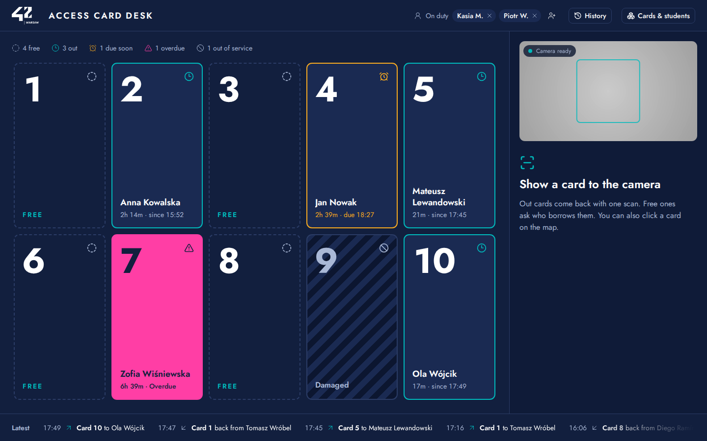
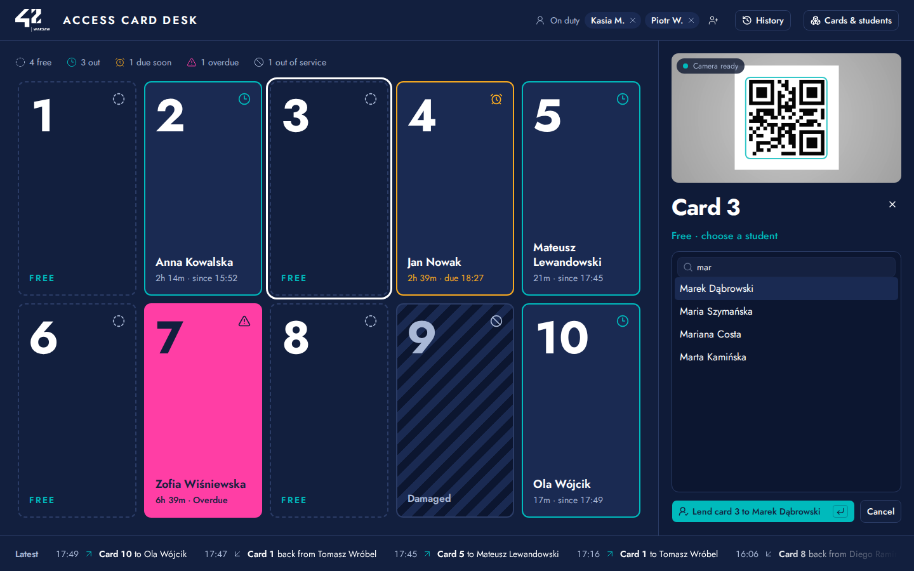
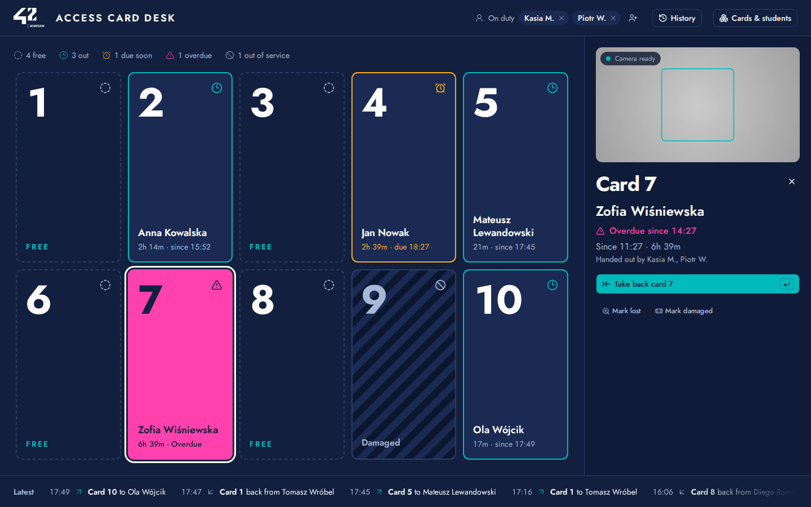
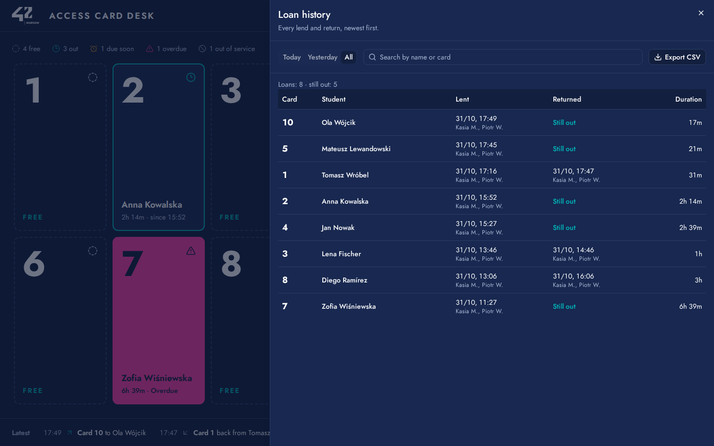
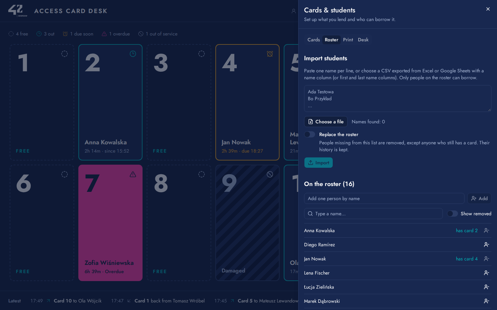
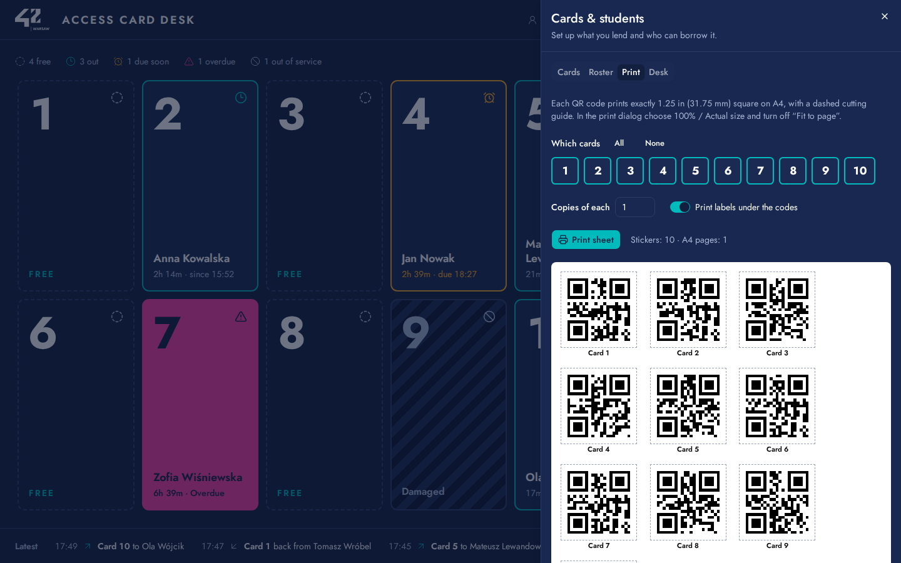
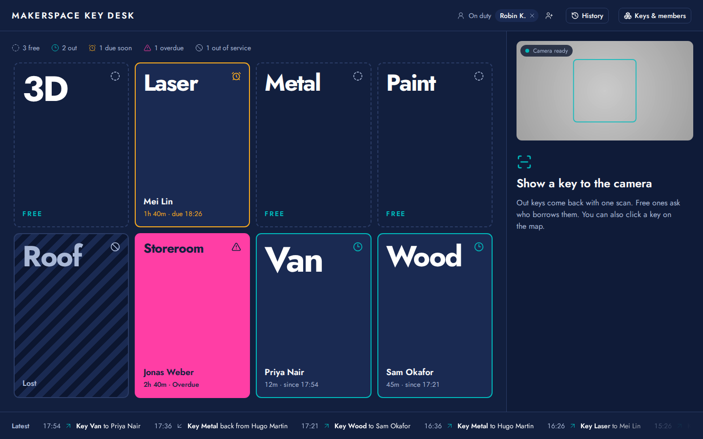
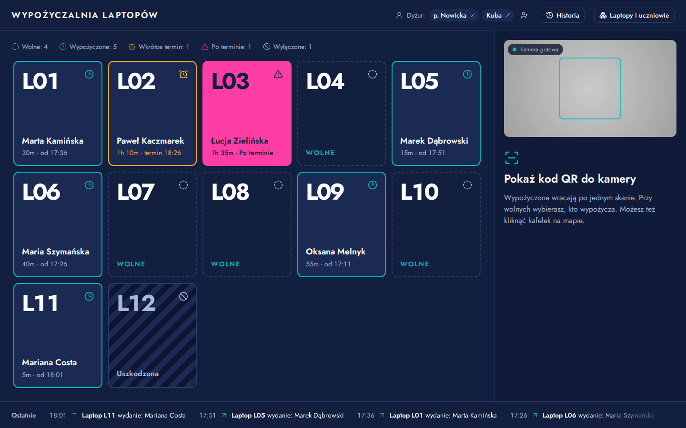
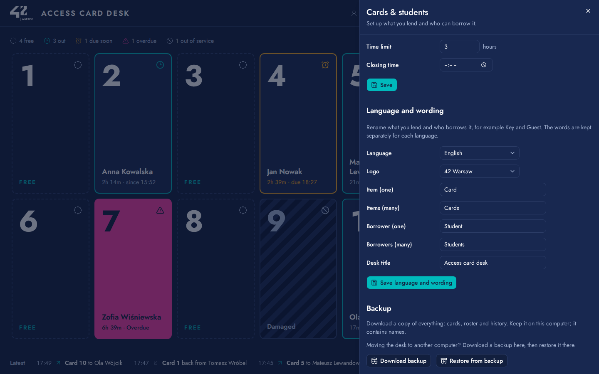

<p align="center">
  
</p>

<h1 align="center">Item Tracker</h1>

<p align="center">
  <i>A lending desk for anything with a QR sticker. Scan an item with the laptop's webcam, and the desk records who has it and since when.</i>
</p>

<p align="center">
  <a href="LICENSE"></a>
  
  <a href="https://github.com/Delta-43/Item_Tracker/commits/main"></a>
  <a href="https://github.com/Delta-43/Item_Tracker/graphs/contributors"></a>
</p>

<p align="center">
  <a href="go.mod"></a>
  <a href="web/package.json"></a>
  <a href="compose.yaml"></a>
  <a href="https://github.com/Delta-43/Item_Tracker/pkgs/container/item_tracker"></a>
  <a href="https://github.com/Delta-43/Item_Tracker/actions/workflows/ci.yml"></a>
  <a href="https://github.com/Delta-43/Item_Tracker/releases/latest"></a>
</p>

<p align="center">
  
  <a href="https://delta-43.github.io/Item_Tracker/"></a>
</p>

<p align="center">
  <a href="#how-it-works">How it works</a> •
  <a href="#examples">Examples</a> •
  <a href="#why-this-design">Why this design</a> •
  <a href="#components">Components</a> •
  <a href="#tech-stack">Tech stack</a> •
  <a href="#project-status">Project status</a> •
  <a href="#quick-start">Quick start</a> •
  <a href="#first-day-setup">First-day setup</a> •
  <a href="#development">Development</a> •
  <a href="#project-structure">Project structure</a> •
  <a href="#license">License</a>
</p>

> **Try it in your browser:** <https://delta-43.github.io/Item_Tracker/>. The demo runs three invented desks (access cards, workshop keys, and laptops with the Polish interface) with no server behind it. Your changes stay in your browser, and **Reset** starts a desk over. See [The demo](#the-demo).

I built Item Tracker for the access card desk at 42 Warsaw. For one week, about 100 students can only enter and leave campus with an access card, and a few volunteers lend out about 10 cards. The volunteers need to lend a card in seconds, take it back, and always know who has card 7 and since when. Item Tracker does that on one Windows laptop with its built-in webcam, and nothing else.

The wording is configurable, so the same desk can lend keys to members, laptops to pupils, or tools to anyone on a list.

---

## How it works

<p align="center">
  
</p>

1. **Show an item to the camera.** The webcam reads the QR sticker in the browser. No internet connection is needed.
2. **A free item asks who borrows it.** Type part of a name and press Enter. Accents and case don't matter, so "lukasz" finds "Łukasz".
3. **A lent item comes back with one scan.** A toast confirms the return, with **Undo** in case of a mistake.
4. **Everything is recorded.** Each lend and return keeps the time and the whole team on duty. Every open tab updates live.

You can also click an item on the map. That works the same as a scan if a sticker is damaged or the light is poor.

<table>
<tr>
<td width="50%"></td>
<td width="50%"></td>
</tr>
<tr>
<td><b>Open a lent item</b> to see who has it, since when, and who handed it out. Take it back, or mark it lost or damaged.</td>
<td><b>History</b> lists every loan, newest first, and exports CSV that opens cleanly in Excel, including Polish characters.</td>
</tr>
<tr>
<td></td>
<td></td>
</tr>
<tr>
<td><b>The roster</b> is strict: only people on it can borrow, and each person holds one item at a time. Import it from a pasted list or a CSV.</td>
<td><b>Print the stickers</b> at exactly 1.25 in (31.75 mm) square on A4, with a 50 mm line to check that the printer didn't scale the page.</td>
</tr>
</table>

The colours on the map tell the state of each item at a glance:

| State | On the map |
|---|---|
| Free | Dashed outline, "Free" |
| Lent | Teal outline, the borrower's name and how long they have had it |
| Due soon | Amber outline and the due time |
| Overdue | Pink, after the time limit or at closing time, whichever comes first |
| Out of service | Striped, marked lost or damaged. It can't be lent until you put it back in service |

## Examples

The same program, set up for three kinds of desks. All names are invented.

<table>
<tr>
<td width="50%"></td>
<td width="50%"></td>
</tr>
<tr>
<td><b>Keys at a makerspace.</b> The items are called "Key", the borrowers "Member", there's no logo, and loans are due after 2 hours.</td>
<td><b>A laptop trolley at a school</b>, in Polish. The items are "Laptop", the borrowers "Uczeń", and loans are due after 90 minutes.</td>
</tr>
</table>

To set up your own wording, open **Cards & students › Desk** (the button takes your item name). Each language keeps its own words, so a desk can switch between English and Polish.

<p align="center">
  
</p>

## Why this design

- **One laptop, one container.** The desk is a single Go program in a 26 MB Docker image. Docker Desktop on Windows or macOS, or Docker Engine on Linux, is all it needs.
- **The webcam is the scanner.** QR decoding runs in the browser ([zxing-wasm](https://github.com/Sec-ant/zxing-wasm) in a Web Worker), bundled with the app. There is no RFID reader to buy and no internet connection to depend on.
- **Scans can't double-fire.** A card acts once per showing. It must leave the camera's view for 1.5 seconds to act again, and two codes in view at once act on neither.
- **The rules live in the database.** SQLite partial unique indexes enforce one open loan per item and one per person, so two tabs can't lend the same card at once.
- **Private by default.** The desk listens only on `127.0.0.1`. The server refuses requests with a foreign `Host` header (DNS rebinding) and writes from other sites (`Origin` check). Names never leave the computer.
- **Volunteer-run, not a kiosk.** Volunteers operate the screen, and everyone on duty (up to five) is recorded with each lend and return.
- **Generic words, two languages.** English and Polish, with renameable items and borrowers, so the desk isn't tied to access cards.

## Components

| Component | Where | Role |
|---|---|---|
| Server | [`cmd/itemtracker`](cmd/itemtracker), [`internal/server`](internal/server) | JSON API, server-sent events for live updates, and the embedded web app, on one port |
| Store | [`internal/store`](internal/store) | Items, borrowers, loans and settings in SQLite ([`modernc.org/sqlite`](https://gitlab.com/cznic/sqlite), pure Go), plus backup and restore |
| Web app | [`web/src`](web/src) | The desk, history, roster, print sheets and settings: React 19, TypeScript, Tailwind 4 and shadcn/ui |
| Scanner | [`web/src/scanner`](web/src/scanner) | Camera capture, QR decoding in a Web Worker, and the presentation gate that stops double scans |
| Demo | [`web/src/demo`](web/src/demo) | An in-browser copy of the API with invented desks, for the GitHub Pages build only |
| Installer | [`install/install.cmd`](install/install.cmd), [`compose.yaml`](compose.yaml) | Windows double-click install and update, and the Compose file |

## Tech stack

<table>
<tr><th>Layer</th><th></th></tr>
<tr><td>Server</td><td>
  
  
  
</td></tr>
<tr><td>Web app</td><td>
  
  
  
  
  
</td></tr>
<tr><td>Scanning</td><td>
  
</td></tr>
<tr><td>Tests</td><td>
  
  
  
</td></tr>
<tr><td>Delivery</td><td>
  
  
  
  
</td></tr>
</table>

## Project status

**Deployed.** Version 1.0 runs the access card desk at 42 Warsaw. It was installed on the school laptop from an offline kit and tested there with the webcam, the printed stickers and the real roster.

| Part | Status | Detail |
|---|---|---|
| Desk: live map, lend, return, undo |  | 1.0 |
| Browser QR scanning, offline |  | 1.0 |
| Strict roster, team on duty (up to five) |  | 1.0 |
| History, CSV export, overdue rules, lost and damaged |  | 1.0 |
| True-size QR sheets, English and Polish, renameable words |  | 1.0 |
| Tested on the school laptop |  | 1.0, with the offline install kit |
| Restore a backup from the app |  | 1.1 |
| Windows double-click installer from the registry |  | 1.1 |
| Demo on GitHub Pages |  | 1.1 |

**Known limits**, all on purpose for a one-laptop desk:

- One computer only. Other devices on the network can't open the desk, and there is no login.
- Scanning needs the camera on the same computer. Phones can't scan for the desk.
- The camera needs reasonable light. In a dark room, click the item on the map instead.

## Quick start

You need [Docker Desktop](https://www.docker.com/products/docker-desktop/) (Windows or macOS) or Docker Engine (Linux), started and running. The image is public at `ghcr.io/delta-43/item_tracker`, for amd64 and arm64. You don't need an account to pull it.

**Windows, double-click:** download [`install.cmd`](https://github.com/Delta-43/Item_Tracker/releases/latest/download/install.cmd) and double-click it. It pulls the latest version, starts the desk, and opens it in the browser. To update later, run it again. Your data is kept.

**Any system, one command** in a terminal (PowerShell, Command Prompt, macOS or Linux):

```sh
docker run -d --name item-tracker --restart always -p 127.0.0.1:4242:4242 -v itemtracker_item-tracker-data:/data ghcr.io/delta-43/item_tracker:latest
```

**Docker Compose:** download [`compose.yaml`](compose.yaml) into a folder, and run `docker compose up -d` in that folder.

Then open <http://localhost:4242> in Chrome, Edge or Firefox, and allow camera access. The desk starts by itself whenever Docker runs.

All three methods keep the data in the same Docker volume, `itemtracker_item-tracker-data`. Use only one method on a computer: the container is called `item-tracker` either way, so a second method reports a name conflict.

| To | Do this |
|---|---|
| Stop or start | Docker Desktop › Containers › `item-tracker`, or `docker stop item-tracker` / `docker start item-tracker` |
| Update | Run `install.cmd` again, or `docker compose pull && docker compose up -d`. With `docker run`: `docker pull ghcr.io/delta-43/item_tracker:latest`, `docker rm -f item-tracker`, then the run command again |
| Pin a version | Use a version tag, for example `ghcr.io/delta-43/item_tracker:1.1.0` (or `:1.1`), instead of `:latest` |
| Move a desk to another computer | Old computer: **Cards & students › Desk › Download backup**. New computer: install, then **Restore from backup** in the same place |
| Remove everything | `docker rm -f item-tracker`, then `docker volume rm itemtracker_item-tracker-data`. This deletes the desk's data |

> [!NOTE]
> **Restore from backup** replaces every item, the roster, the history and the settings. Before it does, the desk saves its current data as `before-restore-<date-time>.db` in its data folder, so you can restore that file to undo it.

## First-day setup

1. **Add your items.** On an empty desk, **Add cards 1 to 10** creates 10 numbered items. To rename an item or set its QR value, use **Cards & students › Cards**. Values printed by an earlier system (for example `carddesk:4242`) keep working.
2. **Import the roster.** In **Cards & students › Roster**, paste one name per line, or choose a CSV with a name column (or first and last name columns).
3. **Print the stickers.** In **Cards & students › Print**, print the sheet. In the print dialog, choose **100% / Actual size** and turn off "Fit to page". Then measure the 50 mm line before you cut.
4. **Set the rules.** In **Cards & students › Desk**, set the overdue time limit, the closing time, the language, the logo, and what the items and borrowers are called.
5. **Put the team on duty.** In the header, click **Nobody on duty**, then the add button for more people.

## The demo

The [GitHub Pages demo](https://delta-43.github.io/Item_Tracker/) is the real web app, built in a demo mode (`npm run build:demo`). In that build, [`web/src/demo`](web/src/demo) answers the API in the browser with the same rules as the server, so you can lend, scan, return, undo, import a roster and print stickers. Use the **Demo** menu to switch between the access card, key and laptop desks.

- Your changes are saved in your browser only. Other tabs of the demo follow along live.
- The camera works too: print the demo's stickers, or show them on a phone, and scan them.
- **Download backup** saves the demo desk as a file, and **Restore from backup** loads it again.
- The normal build never includes the demo code.

## Privacy

Borrower names, the roster and the database live only in the local Docker volume. Nothing is sent anywhere. None of it belongs in this repository: `data/` and `private/` are git-ignored, and the tests, screenshots and demo use invented names.

## Development

You need Go 1.27 and Node.js 24.

```bash
cd web && npm ci && npm run build && cd ..
go run ./cmd/itemtracker
```

The server listens on `:4242`. For live reloading of the web app, keep the Go server running and start Vite in another terminal with `cd web && npm run dev`. It forwards `/api` to the Go server.

| Variable | Default | Purpose |
|---|---|---|
| `ITEMTRACKER_ADDR` | `:4242` | Listen address |
| `ITEMTRACKER_DATA` | `./data` | Folder for the SQLite database |
| `ITEMTRACKER_ALLOWED_HOSTS` | _(empty)_ | Extra host names allowed besides `localhost`, comma-separated |

To build the image yourself, run `docker build -t item-tracker .`.

```bash
go test ./...                       # server
cd web && npm test                  # web app units
npx playwright test                 # end to end; build web/dist and bin/itemtracker first
npm run build:demo                  # the GitHub Pages demo, into web/dist-demo
node scripts/readme-shots.mjs       # the README screenshots, into docs/images
```

The end-to-end suite gives Chromium a fake camera that plays a generated QR code video. So the whole scan path (camera, decoder, lend, return) runs in CI without hardware.

## Project structure

```text
Item_Tracker/
├── cmd/itemtracker/        # main: starts the server, and a healthcheck for the container
├── internal/
│   ├── server/             # HTTP API, Host and Origin guard, live events, embedded web app
│   └── store/              # SQLite schema and rules: items, borrowers, loans, settings, backup, restore
├── web/
│   ├── src/
│   │   ├── components/     # desk map, action panel, history, roster, print sheet, settings
│   │   ├── scanner/        # camera, QR decoder worker, presentation gate
│   │   ├── lib/            # API client, English and Polish text, name matching, CSV
│   │   └── demo/           # in-browser API for the GitHub Pages demo
│   ├── e2e/                # Playwright tests with a fake camera
│   └── scripts/            # README screenshot script
├── install/install.cmd     # Windows install and update
├── docs/images/            # README screenshots (invented names)
├── compose.yaml            # Docker Compose setup
├── Dockerfile              # multi-arch build into a distroless image
├── PRODUCT.md              # who the desk is for, and what it must do
├── DESIGN.md               # the visual design system
└── TRADEMARKS.md           # the 42 Warsaw logo
```

## Documentation

| Doc | What's in it |
|---|---|
| [`PRODUCT.md`](PRODUCT.md) | Who uses the desk, what it must do, and the operating context |
| [`DESIGN.md`](DESIGN.md) | The design system: colours, typography, layout, depth, shapes and components |
| [`TRADEMARKS.md`](TRADEMARKS.md) | The 42 Warsaw logo, and what to do with it if you reuse the desk elsewhere |
| [Releases](https://github.com/Delta-43/Item_Tracker/releases) | What changed in each version, with `install.cmd` and `compose.yaml` attached |

## Prerequisites

- A computer with a webcam: Windows 10 or 11, macOS, or Linux
- Docker Desktop (Windows or macOS) or Docker Engine (Linux)
- Chrome, Edge or Firefox
- A printer for the QR stickers, and items to stick them on

## Acknowledgements

Item Tracker grew out of an idea by **Stanisław Zdanowski**, who built the original card-lending desk for 42 Warsaw's Discovery Piscine. His larger system had a self-service kiosk where students requested cards, volunteer approval from phones, a Stream Deck button panel, QR scanning through the host computer's webcam, and a full label-printing studio. Item Tracker keeps his core idea, QR-tagged items lent to people with a complete record, and reshapes it into a smaller, portable tool that anyone can run.

## License

[MIT](LICENSE) © 2026 Debadeep Chaudhury. The 42 Warsaw logo is a trademark of 42 Warsaw and is not covered by the licence. See [`TRADEMARKS.md`](TRADEMARKS.md).

---

<p align="center">
  <a href="https://github.com/Delta-43/Item_Tracker/graphs/contributors">
    
  </a>
</p>

<p align="center"><sub>Licensed under <a href="LICENSE">MIT</a>.</sub></p>
